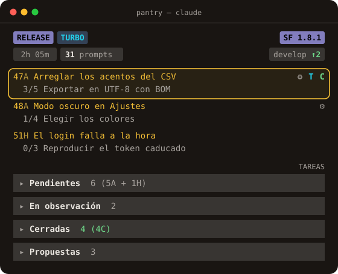
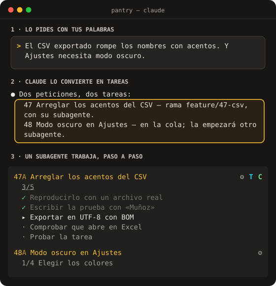
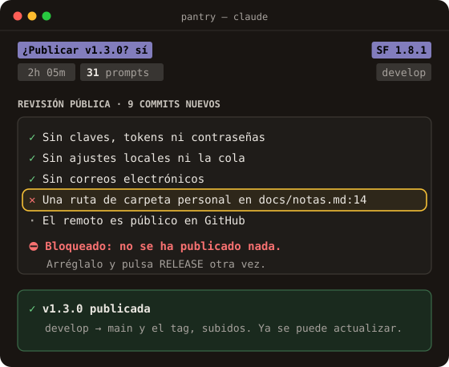

<p align="center">
  
</p>

<h1 align="center">Ve rápido con Claude Code. Sin perder el control.</h1>

<p align="center">
  <b>Un nuevo mod para Claude Code, en la terminal y en la app de escritorio.</b><br>
  Un mod se instala en Claude Code y cambia cómo trabaja, sin cambiar de herramienta. <b>SoftwareFactory</b> le añade un panel en vivo,<br>
  una cola de tareas y una forma de trabajar, para quien construye solo o con poca gente: cada petición es una tarea<br>
  con su subagente y su rama, todas avanzan en paralelo y nada se publica sin revisar los datos privados.
</p>

<p align="center">
  <a href="README.md">🇬🇧 Read in English</a> · 🇪🇸 Castellano
</p>

<p align="center">
  <a href="https://github.com/jumibot/SoftwareFactory/releases"></a>
  <a href="LICENSE"></a>
  
</p>

<p align="center">
  <a href="#instalar"><b>Instálalo con 2 órdenes</b></a> &nbsp;|&nbsp; <a href="https://jumibot.github.io/SoftwareFactory/"><b>Haz el recorrido en la web</b></a>
</p>

<p align="center">
  
</p>

## Instalar

Una sola vez por equipo:

```bash
claude plugin marketplace add jumibot/SoftwareFactory
claude plugin install sf@softwarefactory --scope user
```

Después, abre Claude Code y pídele *«Comprueba la instalación de la SF»*: Claude revisa el plugin y los requisitos y arregla lo que falte, con tu OK. Ábrelo en tu proyecto, pon la pantalla completa con `/tui fullscreen` y pulsa el botón de la bienvenida.

**Necesitas** Claude Code, git, la CLI de GitHub con la sesión iniciada (`gh auth login`) y Python 3.9 o posterior. Instalar `sf` trae solas sus tres dependencias.

## No esperes. Orquesta.

Cada tarea tiene su propio subagente, trabajando en segundo plano en su propia rama. Mientras trabajan, tú sigues hablando con Claude: pides más cosas o pruebas otra tarea. Nunca esperas a que termine una para empezar la siguiente.

- Varios subagentes en paralelo, uno por tarea.
- Cada uno en su rama: no se pisan.
- El panel enseña cada paso según ocurre.

## Publica sin miedo

Antes de subir nada a un repositorio público, SoftwareFactory revisa lo que sale: secretos y claves, correos, rutas de tu máquina, tu usuario y el nombre del equipo, archivos locales. **Si encuentra algo, para: no se sube nada.** Cuando está limpio, RELEASE pasa `develop` a `main`, pone el tag de la versión y lo sube, con un botón.

| Sale | No sale |
|---|---|
| ✓ tu código, tus documentos, el registro de cambios | ✕ tokens y claves (`ghp_…`, claves privadas, contraseñas en el código) |
| ✓ el tag de la versión (`v1.3.0`) en `main` | ✕ correos, tu usuario y el nombre del equipo, rutas de tu carpeta personal |
| ✓ lo que ya era público, sin volver a preguntar | ✕ `.env`, la cola local y los ajustes locales de Claude Code |

## El mismo Claude. Un día muy distinto.

| Claude Code a pelo | Con SoftwareFactory |
|---|---|
| Pides cinco cosas. Tres se pierden en el scroll. | Cada petición entra en una cola en cuanto la dices. |
| Todos los cambios se amontonan en la rama en la que estés. | Cada tarea trabaja en su rama, con su agente, todas a la vez. |
| La lista de pendientes vive en tu cabeza. | Un panel enseña lo que está en marcha, lo que espera y lo hecho. |
| Subes y cruzas los dedos para que no se cuele nada privado. | Cada publicación se revisa en busca de secretos y datos personales. |
| Cada proyecto, a preparar todo otra vez. | Cualquier proyecto queda listo tras unas pocas preguntas. |

## Qué ganas

**Ninguna idea se pierde.** Dilo en el chat, con tus palabras. Antes de empezar nada, ya está en la cola como tarea con sus pasos.

**Tú decides. Claude trabaja.** Cada tarea tiene su propio agente y su propia rama. Nada toca tu código estable hasta que lo pruebas y das el OK. Después, un clic la cierra en un único commit limpio.

**Todo de un vistazo, en la terminal y en la app de escritorio.** El mismo panel en vivo junto al chat, uses Claude Code donde lo uses. Cierra, descarta o revierte una tarea con un clic; TURBO pasa a Claude todas las tareas que no te necesitan.

**Tus proyectos de siempre, sin rehacerlos.** Trae un proyecto que ya tengas, o empieza en una carpeta vacía. Unas pocas preguntas con menús y queda listo, sin mover ni renombrar tu código.

**Método, si lo quieres.** Con la metodología, Claude guía el proyecto de la visión y la especificación al código, en devslices pequeñas, con documentos que de verdad se leen.

| Ninguna idea se pierde | Publica sin miedo |
|:---:|:---:|
|  |  |

<p align="center">
  <a href="https://jumibot.github.io/SoftwareFactory/"><b>Mira todas las funciones en la web</b></a>
</p>

## Más

- [Página web](https://jumibot.github.io/SoftwareFactory/): el recorrido completo, en inglés y en castellano.
- [El plugin](plugins/sf/README.md): qué contiene y cómo se publica.
- [Guía de desarrollo](DESARROLLO.md): para quien trabaja en la propia SoftwareFactory.
- [Licencias de terceros](plugins/sf/LICENCIAS-DE-TERCEROS.md).

SoftwareFactory es software libre con [licencia MIT](LICENSE).
