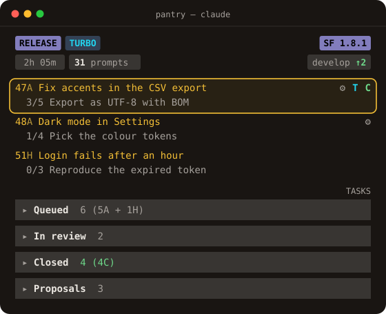
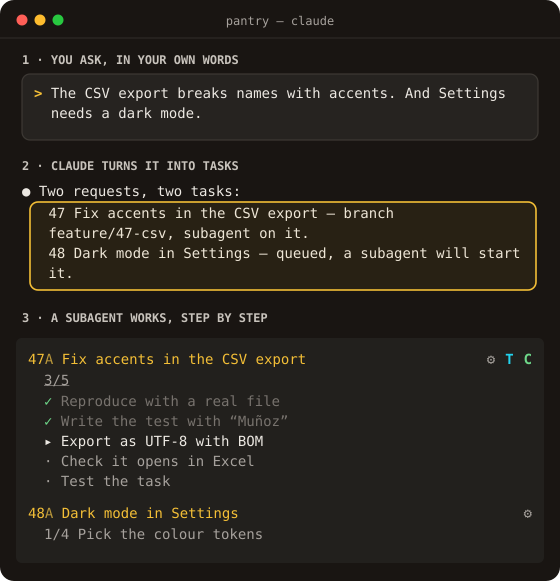
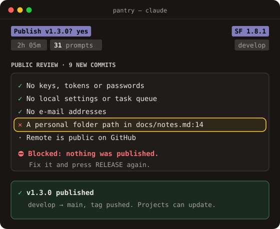

<p align="center">
  
</p>

<h1 align="center">Go fast with Claude Code. Stay in control.</h1>

<p align="center">
  <b>A new mod for Claude Code, in the terminal and the desktop app.</b><br>
  A mod plugs into Claude Code and changes how it works, without switching tools. <b>SoftwareFactory</b> adds a live panel,<br>
  a task queue and a way of working, for people who build alone or with a small team: every request becomes a task<br>
  with its own subagent and branch, they all work in parallel, and nothing goes public without a privacy check.
</p>

<p align="center">
  🇬🇧 English · <a href="README.es.md">🇪🇸 Leer en castellano</a>
</p>

<p align="center">
  <a href="https://github.com/jumibot/SoftwareFactory/releases"></a>
  <a href="LICENSE"></a>
  
</p>

<p align="center">
  <a href="#install"><b>Install in 2 commands</b></a> &nbsp;|&nbsp; <a href="https://jumibot.github.io/SoftwareFactory/"><b>Take the tour on the website</b></a>
</p>

<p align="center">
  
</p>

## Install

Once per computer:

```bash
claude plugin marketplace add jumibot/SoftwareFactory
claude plugin install sf@softwarefactory --scope user
```

Then open Claude Code and ask *“Check the SF installation”*: Claude reviews the plugin and the requirements and fixes what is missing, with your OK. Open it in your project, go full screen with `/tui fullscreen` and press the button on the welcome screen.

**You need** Claude Code, git, the GitHub CLI signed in (`gh auth login`) and Python 3.9 or later. Installing `sf` brings its three dependencies on its own.

## Don’t wait. Orchestrate.

Every task gets its own subagent, working in the background on its own branch. While they work, you keep talking to Claude: ask for more, or test another task. You never wait for one to finish before starting the next.

- Several subagents in parallel, one per task.
- Each on its own branch: they never step on each other.
- The panel shows every step as it happens.

## Publish without fear

Before anything goes up to a public repository, SoftwareFactory checks what is leaving: secrets and keys, e-mails, paths from your machine, your user and machine name, local files. **If it finds something, it stops: nothing is pushed.** When it is clean, RELEASE moves `develop` to `main`, tags the version and pushes it, with one button.

| Goes out | Stays home |
|---|---|
| ✓ your code, your docs, the changelog | ✕ tokens and keys (`ghp_…`, private keys, passwords in code) |
| ✓ the version tag (`v1.3.0`) on `main` | ✕ e-mails, your user and machine name, your home folder paths |
| ✓ what was already public, without asking again | ✕ `.env`, the local queue and Claude Code local settings |

## Same Claude. A very different day.

| Claude Code on its own | With SoftwareFactory |
|---|---|
| You ask for five things. Three get lost in the scroll. | Every request lands in a queue the moment you say it. |
| Every change piles up on the branch you happen to be on. | Each task works on its own branch, with its own agent, all at once. |
| The to-do list lives in your head. | One panel shows what is running, waiting and done. |
| You push and hope nothing private slipped in. | Every release is checked for secrets and personal data. |
| Each project means setting things up again. | Any project is ready after a few questions. |

## What you get

**No idea gets lost.** Say it in the chat, in your own words. Before any work starts, it is in the queue as a task with its steps.

**You decide. Claude does the work.** Each task gets its own agent and its own branch. Nothing touches your stable code until you have tested it and said OK. Then one click closes it into one clean commit.

**Everything at a glance, in the terminal and in the desktop app.** The same live panel beside the chat, wherever you use Claude Code. Close, discard or revert a task with a click; TURBO hands Claude every task that does not need you.

**Your projects, as they are.** Bring in a project you already have, or start from an empty folder. A few questions as menus and it is ready, without moving or renaming your code.

**A method, if you want one.** Turn it on and Claude guides the project from vision and spec to code, in small vertical slices, with documents people actually read.

| No idea gets lost | Publish without fear |
|:---:|:---:|
|  |  |

Good to know: today the panel and the generated documents are in Spanish; Claude talks to you in your language.

<p align="center">
  <a href="https://jumibot.github.io/SoftwareFactory/"><b>See every feature on the website</b></a>
</p>

## More

- [Website](https://jumibot.github.io/SoftwareFactory/): the full tour, in English and Spanish.
- [The plugin](plugins/sf/README.md): what it contains and how it is published (in Spanish).
- [Development guide](DESARROLLO.md): for those working on SoftwareFactory itself (in Spanish).
- [Third-party licences](plugins/sf/LICENCIAS-DE-TERCEROS.md).

SoftwareFactory is free software under the [MIT licence](LICENSE).
