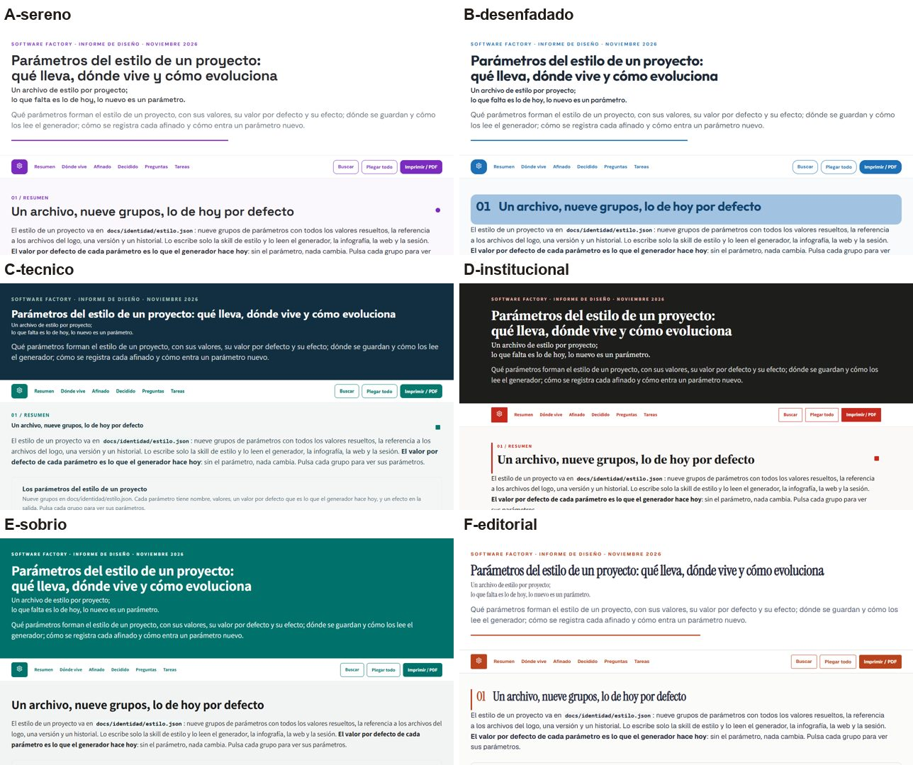
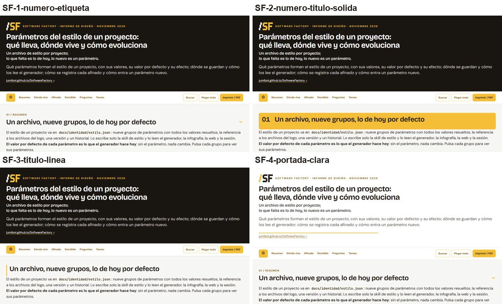
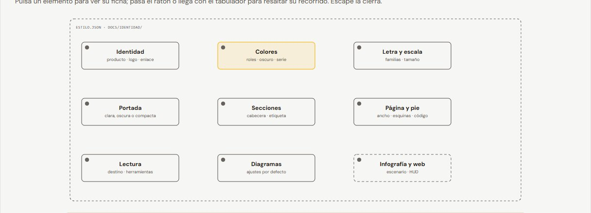

# Muestras de estilo y estilo de partida de la SF

## Resumen | Seis muestras y un amarillo con tres roles | Resumen {#resumen}

Se propone un **juego de seis muestras**, una por tema del catálogo, cada una con una forma distinta (portada, cabecera de sección, marcador, esquinas, letra), para que se distingan a primera vista y no solo por el color. Cada muestra es un **`estilo.json` completo**, con todos los valores resueltos y su tema como `origen` (decisión 317). Las seis se han generado con el generador único sobre un informe real y ninguna tiene un texto por debajo de 4,5:1; la del tema `pool` ha necesitado oscurecer su acento.

Para la SF se propone un **estilo de partida en el amarillo de la web** (decisión 304) que nace del tema `tinta`, con el amarillo como `primario`, la tinta de la web como `sobre-primario` (9,9:1) y su ámbar oscuro como `primario-texto` (5,7:1 sobre la página); la letra, la de la web (decisión 312); y la portada oscura en grafito con el logo en amarillo. Pasa la comprobación de contraste del generador. Queda un problema que el generador no mira: **los diagramas pintan con el primario los trazos del foco y las flechas principales**, y el amarillo sobre la página da 1,6:1.

Quedan **nueve preguntas**: cinco del estilo de la SF, dos del juego de muestras y dos de contraste. Salen tres tareas nuevas y dos pasos en tareas que ya existen.

[Ver las nueve preguntas](#por-decidir){: .salto} [Ver las tareas](#tareas){: .salto}

## Muestras | Seis formas, una por tema del catálogo | Muestras {#muestras}

Cada muestra parte de un tema del catálogo con todos sus colores resueltos (los que el tema no da, derivados como hace el generador) y le añade una forma propia. Lo que no dice la tabla toma su valor por defecto: portada clara, cabecera `numero-etiqueta`, etiqueta `tinte`, marcador `flecha`, ancho 1240, letra de 17 px, escala editorial, diagramas con el tema del documento.

| Muestra | Origen | Carácter | Lo que cambia sobre el tema |
| --- | --- | --- | --- |
| A · Sereno | `morado` | Morado con acento ámbar, Space Grotesk | Marcador `circulo`, esquinas 10 |
| B · Desenfadado | `colorido` | Un color por sección, Outfit | Cabecera `numero-titulo`, etiqueta `solida` al 0,4, sin marcador, esquinas 16 |
| C · Técnico | `pool` | Azul marino y verde, letra del sistema | Portada oscura, escala compacta de 16 px, marcador `cuadrado`, todo plegado, pie oscuro; acento `#8f5817` y sin serie (ver abajo) |
| D · Institucional | `rojo` | Rojo y negro, títulos con serifa | Portada oscura, etiqueta `linea`, marcador `cuadrado`, esquinas 2, ancho 1100 |
| E · Sobrio | `teal` | Verde azulado, Assistant | Portada oscura sobre el primario, cabecera `titulo`, sin marcador, esquinas 6 |
| F · Editorial | `tinta` | Papel, tinta y óxido, Instrument Serif | Cabecera `numero-titulo`, etiqueta `linea`, sin marcador, esquinas 4, código en línea, 18 px |

<figure>

<figcaption>Las seis muestras con el mismo documento: se distinguen por la forma de la portada y de la cabecera de sección, no solo por el color.</figcaption>
</figure>

::: tarjetas 2

### Lo que dio la comprobación {color=correcto icono=check}

Textos
:   Ninguno por debajo de 4,5:1 en las seis muestras.

Bordes
:   Las seis avisan: los bordes de las cajas y de los campos dan entre 1,2 y 1,9:1, y las líneas de los diagramas de A a D entre 2,4 y 2,7:1 ([pregunta 9](#p9)).

### Lo que no pasó: el tema pool {color=aviso icono=aviso}

Acento
:   `#b36e1d` da 4,07:1 sobre blanco y 3,68:1 sobre su fondo; en la muestra va `#8f5817`.

Serie
:   Los colores 2 y 6 dan 3,7:1 y 2,9:1: la muestra va sin serie. El tema del catálogo se arregla aparte ([tareas](#tareas)).

:::

La muestra se hizo con el informe «Parámetros del estilo de un proyecto» (387), que trae diagramas, preguntas, tarjetas y tablas, pero no código ni recuadros de aviso; un documento de muestra propio los tendría todos ([pregunta 7](#p7)). Como el generador es determinista, las muestras no se guardan: se rehacen con el juego de valores y el documento de muestra (informe 387).

## Estilo de la SF | El amarillo, sus roles, la portada y el logo | Estilo SF {#estilo-sf}

El estilo de la SF parte del tema `tinta`, el más cercano a la web: papel neutro, tinta grafito y un solo color de marca. Sobre él, los colores de la web pasados a `#rrggbb` y su letra. El `estilo.json` completo está en el [anexo](#anexo).

<figure class="vertical">
<svg viewBox="0 0 560 236" role="img" aria-label="Los roles del amarillo de la SF con su contraste" style="max-width:560px;width:100%;height:auto" font-family="DM Sans, sans-serif">
<rect x="0" y="0" width="560" height="236" rx="8" fill="#f6f6f4"/>
<rect x="16" y="16" width="120" height="56" rx="6" fill="#f4bf36"/><text x="76" y="50" text-anchor="middle" font-size="15" font-weight="700" fill="#211c17">Aa 9,9:1</text>
<text x="152" y="38" font-size="14" font-weight="700" fill="#211c17">primario #f4bf36 · sobre-primario #211c17</text>
<text x="152" y="58" font-size="13" fill="#524c46">Botones, cabecera sólida, marcas. Solo como fondo.</text>
<rect x="16" y="88" width="120" height="56" rx="6" fill="#ffffff" stroke="#d6d4d0"/><text x="76" y="122" text-anchor="middle" font-size="15" font-weight="700" fill="#895709">Aa 6,1:1</text>
<text x="152" y="110" font-size="14" font-weight="700" fill="#211c17">primario-texto #895709</text>
<text x="152" y="130" font-size="13" fill="#524c46">Enlaces, rótulos, números de sección. 5,7:1 en la página.</text>
<rect x="16" y="160" width="120" height="56" rx="6" fill="#191511"/><text x="76" y="194" text-anchor="middle" font-size="15" font-weight="700" fill="#f4bf36">Aa 10,7:1</text>
<text x="152" y="182" font-size="14" font-weight="700" fill="#211c17">oscuro #191511 · tenue #f4bf36</text>
<text x="152" y="202" font-size="13" fill="#524c46">Portada oscura y cabeceras de tabla, con la marca en amarillo.</text>
</svg>
<figcaption>Tres roles para un primario claro (decisión 319): el amarillo nunca va como texto sobre papel, que daría 1,6:1.</figcaption>
</figure>

Las cuatro variantes generadas cambian solo la portada y la cabecera de sección:

| Variante | Portada | Cabecera de sección |
| --- | --- | --- |
| SF-1 | Oscura, grafito | `numero-etiqueta`, etiqueta `tinte`: «01 / RESUMEN» en ámbar y el título en tinta |
| SF-2 | Oscura, grafito | `numero-titulo`, etiqueta `solida`: banda amarilla con el número y el título en tinta, como el botón de la web |
| SF-3 | Oscura, grafito | `titulo`, etiqueta `linea`: solo el título, con una raya amarilla a la izquierda |
| SF-4 | Clara, con la raya amarilla bajo el titular | Como SF-1 |

<figure>

<figcaption>Las cuatro variantes de la SF. En SF-2 el texto de la sección queda pegado a la banda: le falta un hueco debajo (arreglo del generador).</figcaption>
</figure>

### El logo en amarillo {: #logo}

El logo «/SF» de hoy (la web, `site/img/logo.svg`, y el del panel, `hooks/logo.ts`) sigue en morado. El estilo cita sus archivos en `identidad.logo` y `identidad.logo-oscuro` (decisión 316); se proponen dos archivos en `docs/identidad/`, `logo.svg` y `logo-oscuro.svg`, con el mismo dibujo y otros colores.

<figure class="vertical"><svg viewBox="0 0 556 150" role="img" aria-label="Tres versiones del logo /SF en amarillo: dos para la portada clara y una para la oscura" style="max-width:560px;width:100%;height:auto" shape-rendering="crispEdges" font-family="DM Sans, sans-serif"><g transform="translate(0,0)"><rect width="180" height="150" rx="8" fill="#f6f6f4" stroke="#d6d4d0"/><g transform="translate(36,22)"><rect x="12.0" y="0.0" width="6.3" height="12.3" fill="#f4bf36"/><rect x="18.0" y="0.0" width="6.3" height="12.3" fill="#f4bf36"/><rect x="6.0" y="18.0" width="6.3" height="6.3" fill="#f4bf36"/><rect x="12.0" y="12.0" width="6.3" height="12.3" fill="#f4bf36"/><rect x="18.0" y="12.0" width="6.3" height="6.3" fill="#f4bf36"/><rect x="6.0" y="24.0" width="6.3" height="12.3" fill="#f4bf36"/><rect x="12.0" y="24.0" width="6.3" height="12.3" fill="#f4bf36"/><rect x="0.0" y="42.0" width="6.3" height="6.3" fill="#f4bf36"/><rect x="6.0" y="36.0" width="6.3" height="12.3" fill="#f4bf36"/><rect x="12.0" y="36.0" width="6.3" height="6.3" fill="#f4bf36"/><rect x="0.0" y="48.0" width="6.3" height="12.3" fill="#f4bf36"/><rect x="6.0" y="48.0" width="6.3" height="12.3" fill="#f4bf36"/><rect x="30.0" y="6.0" width="6.3" height="6.3" fill="#211c17"/><rect x="36.0" y="0.0" width="6.3" height="12.3" fill="#211c17"/><rect x="42.0" y="0.0" width="6.3" height="12.3" fill="#211c17"/><rect x="48.0" y="0.0" width="6.3" height="12.3" fill="#211c17"/><rect x="54.0" y="0.0" width="6.3" height="12.3" fill="#211c17"/><rect x="60.0" y="0.0" width="6.3" height="12.3" fill="#211c17"/><rect x="72.0" y="0.0" width="6.3" height="12.3" fill="#211c17"/><rect x="78.0" y="0.0" width="6.3" height="12.3" fill="#211c17"/><rect x="84.0" y="0.0" width="6.3" height="12.3" fill="#211c17"/><rect x="90.0" y="0.0" width="6.3" height="12.3" fill="#211c17"/><rect x="96.0" y="0.0" width="6.3" height="12.3" fill="#211c17"/><rect x="102.0" y="0.0" width="6.3" height="12.3" fill="#211c17"/><rect x="30.0" y="12.0" width="6.3" height="12.3" fill="#211c17"/><rect x="36.0" y="12.0" width="6.3" height="12.3" fill="#211c17"/><rect x="72.0" y="12.0" width="6.3" height="12.3" fill="#211c17"/><rect x="78.0" y="12.0" width="6.3" height="12.3" fill="#211c17"/><rect x="30.0" y="24.0" width="6.3" height="6.3" fill="#211c17"/><rect x="36.0" y="24.0" width="6.3" height="12.3" fill="#211c17"/><rect x="42.0" y="24.0" width="6.3" height="12.3" fill="#211c17"/><rect x="48.0" y="24.0" width="6.3" height="12.3" fill="#211c17"/><rect x="54.0" y="24.0" width="6.3" height="12.3" fill="#211c17"/><rect x="60.0" y="30.0" width="6.3" height="6.3" fill="#211c17"/><rect x="72.0" y="24.0" width="6.3" height="12.3" fill="#211c17"/><rect x="78.0" y="24.0" width="6.3" height="12.3" fill="#211c17"/><rect x="84.0" y="24.0" width="6.3" height="12.3" fill="#211c17"/><rect x="90.0" y="24.0" width="6.3" height="12.3" fill="#211c17"/><rect x="96.0" y="24.0" width="6.3" height="12.3" fill="#211c17"/><rect x="54.0" y="36.0" width="6.3" height="12.3" fill="#211c17"/><rect x="60.0" y="36.0" width="6.3" height="12.3" fill="#211c17"/><rect x="72.0" y="36.0" width="6.3" height="12.3" fill="#211c17"/><rect x="78.0" y="36.0" width="6.3" height="12.3" fill="#211c17"/><rect x="30.0" y="48.0" width="6.3" height="12.3" fill="#211c17"/><rect x="36.0" y="48.0" width="6.3" height="12.3" fill="#211c17"/><rect x="42.0" y="48.0" width="6.3" height="12.3" fill="#211c17"/><rect x="48.0" y="48.0" width="6.3" height="12.3" fill="#211c17"/><rect x="54.0" y="48.0" width="6.3" height="12.3" fill="#211c17"/><rect x="60.0" y="48.0" width="6.3" height="6.3" fill="#211c17"/><rect x="72.0" y="48.0" width="6.3" height="12.3" fill="#211c17"/><rect x="78.0" y="48.0" width="6.3" height="12.3" fill="#211c17"/></g><text x="90" y="112" text-anchor="middle" font-size="14" font-weight="700" fill="#211c17">A · clara</text><text x="90" y="132" text-anchor="middle" font-size="12" fill="#211c17">letras en tinta, barra amarilla</text></g><g transform="translate(188,0)"><rect width="180" height="150" rx="8" fill="#f6f6f4" stroke="#d6d4d0"/><g transform="translate(36,22)"><rect x="12.0" y="0.0" width="6.3" height="12.3" fill="#f4bf36"/><rect x="18.0" y="0.0" width="6.3" height="12.3" fill="#f4bf36"/><rect x="6.0" y="18.0" width="6.3" height="6.3" fill="#f4bf36"/><rect x="12.0" y="12.0" width="6.3" height="12.3" fill="#f4bf36"/><rect x="18.0" y="12.0" width="6.3" height="6.3" fill="#f4bf36"/><rect x="6.0" y="24.0" width="6.3" height="12.3" fill="#f4bf36"/><rect x="12.0" y="24.0" width="6.3" height="12.3" fill="#f4bf36"/><rect x="0.0" y="42.0" width="6.3" height="6.3" fill="#f4bf36"/><rect x="6.0" y="36.0" width="6.3" height="12.3" fill="#f4bf36"/><rect x="12.0" y="36.0" width="6.3" height="6.3" fill="#f4bf36"/><rect x="0.0" y="48.0" width="6.3" height="12.3" fill="#f4bf36"/><rect x="6.0" y="48.0" width="6.3" height="12.3" fill="#f4bf36"/><rect x="30.0" y="6.0" width="6.3" height="6.3" fill="#b37903"/><rect x="36.0" y="0.0" width="6.3" height="12.3" fill="#b37903"/><rect x="42.0" y="0.0" width="6.3" height="12.3" fill="#b37903"/><rect x="48.0" y="0.0" width="6.3" height="12.3" fill="#b37903"/><rect x="54.0" y="0.0" width="6.3" height="12.3" fill="#b37903"/><rect x="60.0" y="0.0" width="6.3" height="12.3" fill="#b37903"/><rect x="72.0" y="0.0" width="6.3" height="12.3" fill="#b37903"/><rect x="78.0" y="0.0" width="6.3" height="12.3" fill="#b37903"/><rect x="84.0" y="0.0" width="6.3" height="12.3" fill="#b37903"/><rect x="90.0" y="0.0" width="6.3" height="12.3" fill="#b37903"/><rect x="96.0" y="0.0" width="6.3" height="12.3" fill="#b37903"/><rect x="102.0" y="0.0" width="6.3" height="12.3" fill="#b37903"/><rect x="30.0" y="12.0" width="6.3" height="12.3" fill="#b37903"/><rect x="36.0" y="12.0" width="6.3" height="12.3" fill="#b37903"/><rect x="72.0" y="12.0" width="6.3" height="12.3" fill="#b37903"/><rect x="78.0" y="12.0" width="6.3" height="12.3" fill="#b37903"/><rect x="30.0" y="24.0" width="6.3" height="6.3" fill="#b37903"/><rect x="36.0" y="24.0" width="6.3" height="12.3" fill="#b37903"/><rect x="42.0" y="24.0" width="6.3" height="12.3" fill="#b37903"/><rect x="48.0" y="24.0" width="6.3" height="12.3" fill="#b37903"/><rect x="54.0" y="24.0" width="6.3" height="12.3" fill="#b37903"/><rect x="60.0" y="30.0" width="6.3" height="6.3" fill="#b37903"/><rect x="72.0" y="24.0" width="6.3" height="12.3" fill="#b37903"/><rect x="78.0" y="24.0" width="6.3" height="12.3" fill="#b37903"/><rect x="84.0" y="24.0" width="6.3" height="12.3" fill="#b37903"/><rect x="90.0" y="24.0" width="6.3" height="12.3" fill="#b37903"/><rect x="96.0" y="24.0" width="6.3" height="12.3" fill="#b37903"/><rect x="54.0" y="36.0" width="6.3" height="12.3" fill="#b37903"/><rect x="60.0" y="36.0" width="6.3" height="12.3" fill="#b37903"/><rect x="72.0" y="36.0" width="6.3" height="12.3" fill="#b37903"/><rect x="78.0" y="36.0" width="6.3" height="12.3" fill="#b37903"/><rect x="30.0" y="48.0" width="6.3" height="12.3" fill="#b37903"/><rect x="36.0" y="48.0" width="6.3" height="12.3" fill="#b37903"/><rect x="42.0" y="48.0" width="6.3" height="12.3" fill="#b37903"/><rect x="48.0" y="48.0" width="6.3" height="12.3" fill="#b37903"/><rect x="54.0" y="48.0" width="6.3" height="12.3" fill="#b37903"/><rect x="60.0" y="48.0" width="6.3" height="6.3" fill="#b37903"/><rect x="72.0" y="48.0" width="6.3" height="12.3" fill="#b37903"/><rect x="78.0" y="48.0" width="6.3" height="12.3" fill="#b37903"/></g><text x="90" y="112" text-anchor="middle" font-size="14" font-weight="700" fill="#211c17">B · clara</text><text x="90" y="132" text-anchor="middle" font-size="12" fill="#211c17">letras ámbar, barra amarilla</text></g><g transform="translate(376,0)"><rect width="180" height="150" rx="8" fill="#191511" stroke="#d6d4d0"/><g transform="translate(36,22)"><rect x="12.0" y="0.0" width="6.3" height="12.3" fill="#f1eee9"/><rect x="18.0" y="0.0" width="6.3" height="12.3" fill="#f1eee9"/><rect x="6.0" y="18.0" width="6.3" height="6.3" fill="#f1eee9"/><rect x="12.0" y="12.0" width="6.3" height="12.3" fill="#f1eee9"/><rect x="18.0" y="12.0" width="6.3" height="6.3" fill="#f1eee9"/><rect x="6.0" y="24.0" width="6.3" height="12.3" fill="#f1eee9"/><rect x="12.0" y="24.0" width="6.3" height="12.3" fill="#f1eee9"/><rect x="0.0" y="42.0" width="6.3" height="6.3" fill="#f1eee9"/><rect x="6.0" y="36.0" width="6.3" height="12.3" fill="#f1eee9"/><rect x="12.0" y="36.0" width="6.3" height="6.3" fill="#f1eee9"/><rect x="0.0" y="48.0" width="6.3" height="12.3" fill="#f1eee9"/><rect x="6.0" y="48.0" width="6.3" height="12.3" fill="#f1eee9"/><rect x="30.0" y="6.0" width="6.3" height="6.3" fill="#f4bf36"/><rect x="36.0" y="0.0" width="6.3" height="12.3" fill="#f4bf36"/><rect x="42.0" y="0.0" width="6.3" height="12.3" fill="#f4bf36"/><rect x="48.0" y="0.0" width="6.3" height="12.3" fill="#f4bf36"/><rect x="54.0" y="0.0" width="6.3" height="12.3" fill="#f4bf36"/><rect x="60.0" y="0.0" width="6.3" height="12.3" fill="#f4bf36"/><rect x="72.0" y="0.0" width="6.3" height="12.3" fill="#f4bf36"/><rect x="78.0" y="0.0" width="6.3" height="12.3" fill="#f4bf36"/><rect x="84.0" y="0.0" width="6.3" height="12.3" fill="#f4bf36"/><rect x="90.0" y="0.0" width="6.3" height="12.3" fill="#f4bf36"/><rect x="96.0" y="0.0" width="6.3" height="12.3" fill="#f4bf36"/><rect x="102.0" y="0.0" width="6.3" height="12.3" fill="#f4bf36"/><rect x="30.0" y="12.0" width="6.3" height="12.3" fill="#f4bf36"/><rect x="36.0" y="12.0" width="6.3" height="12.3" fill="#f4bf36"/><rect x="72.0" y="12.0" width="6.3" height="12.3" fill="#f4bf36"/><rect x="78.0" y="12.0" width="6.3" height="12.3" fill="#f4bf36"/><rect x="30.0" y="24.0" width="6.3" height="6.3" fill="#f4bf36"/><rect x="36.0" y="24.0" width="6.3" height="12.3" fill="#f4bf36"/><rect x="42.0" y="24.0" width="6.3" height="12.3" fill="#f4bf36"/><rect x="48.0" y="24.0" width="6.3" height="12.3" fill="#f4bf36"/><rect x="54.0" y="24.0" width="6.3" height="12.3" fill="#f4bf36"/><rect x="60.0" y="30.0" width="6.3" height="6.3" fill="#f4bf36"/><rect x="72.0" y="24.0" width="6.3" height="12.3" fill="#f4bf36"/><rect x="78.0" y="24.0" width="6.3" height="12.3" fill="#f4bf36"/><rect x="84.0" y="24.0" width="6.3" height="12.3" fill="#f4bf36"/><rect x="90.0" y="24.0" width="6.3" height="12.3" fill="#f4bf36"/><rect x="96.0" y="24.0" width="6.3" height="12.3" fill="#f4bf36"/><rect x="54.0" y="36.0" width="6.3" height="12.3" fill="#f4bf36"/><rect x="60.0" y="36.0" width="6.3" height="12.3" fill="#f4bf36"/><rect x="72.0" y="36.0" width="6.3" height="12.3" fill="#f4bf36"/><rect x="78.0" y="36.0" width="6.3" height="12.3" fill="#f4bf36"/><rect x="30.0" y="48.0" width="6.3" height="12.3" fill="#f4bf36"/><rect x="36.0" y="48.0" width="6.3" height="12.3" fill="#f4bf36"/><rect x="42.0" y="48.0" width="6.3" height="12.3" fill="#f4bf36"/><rect x="48.0" y="48.0" width="6.3" height="12.3" fill="#f4bf36"/><rect x="54.0" y="48.0" width="6.3" height="12.3" fill="#f4bf36"/><rect x="60.0" y="48.0" width="6.3" height="6.3" fill="#f4bf36"/><rect x="72.0" y="48.0" width="6.3" height="12.3" fill="#f4bf36"/><rect x="78.0" y="48.0" width="6.3" height="12.3" fill="#f4bf36"/></g><text x="90" y="112" text-anchor="middle" font-size="14" font-weight="700" fill="#f1eee9">Oscura</text><text x="90" y="132" text-anchor="middle" font-size="12" fill="#f1eee9">letras amarillas, barra clara</text></g></svg><figcaption>El logo «/SF» de hoy, cambiado solo de color: dos versiones para la portada clara y la de la oscura.</figcaption></figure>

### Los diagramas con un primario claro {: #diagramas}

`diagramas.css` pinta con `--primario` el borde del nodo en foco, las flechas principales, sus puntas, el punto del foco y el texto de acento. Con el amarillo, el borde del foco y las flechas dan 1,6:1 sobre la página (los objetos gráficos piden 3:1), y el texto de acento, 1,6:1 (pide 4,5:1). La comprobación del generador no lo ve, porque mira el documento y no el diagrama.

<figure>

<figcaption>El nodo en foco («Colores») se distingue por su relleno, no por su borde amarillo.</figcaption>
</figure>

## Por decidir | Nueve preguntas, por importancia | Por decidir {#por-decidir}

Las cinco primeras fijan el estilo de partida de la SF; la 6 y la 7, el juego de muestras que usará la skill de estilo (392); la 8 y la 9, dos arreglos de contraste.

::: preguntas 2 plegables

### 1 · Los roles del amarillo {recomendada=A} {: #p1}

El amarillo de la web no sirve como texto ni lleva texto blanco encima.

Opción A
:   `primario` #f4bf36, `sobre-primario` #211c17 (9,9:1), `primario-texto` #895709 (5,7:1): los tres de la web (`--accent`, `--on-accent`, `--accent-ink`).

Opción B
:   Lo mismo, pero `primario-texto` en la tinta #211c17: los rótulos y enlaces en negro y el amarillo solo de fondo.

Recomendación
:   **A.** Es lo que ya usa la web y deja ver el color de la SF también en los rótulos.

### 2 · La cabecera de sección de la SF {recomendada=B} {: #p2}

`secciones.cabecera` y `secciones.etiqueta` (decisión 321). Ver las variantes en [Estilo de la SF](#estilo-sf).

Opción A
:   SF-1: `numero-etiqueta` con etiqueta `tinte`, la de hoy en ámbar.

Opción B
:   SF-2: `numero-titulo` en banda amarilla sólida con texto en tinta, como el botón de la web. Con las secciones plegadas, la página es una pila de bandas amarillas.

Opción C
:   SF-3: `titulo` con raya amarilla, sin número.

Recomendación
:   **B.** Es la que más dice «SF» y la que más se parece a la web; la raya de C da 1,6:1 y apenas se ve.

### 3 · La portada {recomendada=A} {: #p3}

Opción A
:   Oscura, en el grafito de la franja de la web, con el logo y la marca en amarillo (SF-1).

Opción B
:   Clara, con el logo en tinta y la raya amarilla bajo el titular (SF-4).

Recomendación
:   **A.** El amarillo luce sobre el grafito (10,7:1) y es el mismo contraste que la franja de la web y el terminal.

### 4 · El logo {recomendada=A} {: #p4}

Ver [El logo en amarillo](#logo).

Opción A
:   `logo.svg` con las letras en tinta y la barra amarilla, para la portada clara; `logo-oscuro.svg` con las letras amarillas y la barra clara, para la oscura.

Opción B
:   `logo.svg` con las letras en ámbar #b37903 (3,4:1) y la barra amarilla; el mismo `logo-oscuro.svg`.

Recomendación
:   **A.** Las letras se leen en cualquier fondo claro y el amarillo queda en la barra, que es la tecla de «/sf».

### 5 · La letra {recomendada=A} {: #p5}

La web comparte los colores y la letra del estilo de la SF (decisión 312).

Opción A
:   La de la web: Bricolage Grotesque en los títulos, DM Sans en el texto y JetBrains Mono en el código.

Opción B
:   La del tema de origen, `tinta`: Geist e Instrument Serif; la web la toma después (tarea 395).

Recomendación
:   **A.** La web ya está hecha y probada con ella; cambiarla sería un trabajo sin pedir.

### 6 · El juego de muestras {recomendada=B} {: #p6}

Opción A
:   Las seis de la tabla, una por tema del catálogo.

Opción B
:   Las seis y, si el color del proyecto no se parece a ninguno, una séptima: su color como `primario` sobre la forma de la muestra de tono más cercano.

Opción C
:   Tres: una clara (A), una editorial (F) y una de portada oscura (D).

Recomendación
:   **B.** Seis formas dan donde elegir, y la séptima enseña el proyecto con su propio color desde la primera vuelta.

### 7 · El documento de muestra {recomendada=B} {: #p7}

Opción A
:   Un informe real de la SF, como el de esta prueba.

Opción B
:   Un documento corto hecho para eso, en el plugin, con un ejemplo de cada recurso: portada, secciones, tarjetas, recuadros, pregunta, tabla, código y un diagrama.

Recomendación
:   **B.** Se compara de un vistazo y no deja fuera ningún recurso; el informe 387 no tiene código ni recuadros de aviso.

### 8 · Los diagramas con un primario claro {recomendada=A} {: #p8}

Ver [Los diagramas con un primario claro](#diagramas).

Opción A
:   Un rol nuevo, `primario-linea`, para los trazos: el primario si da 3:1 sobre la página y, si no, oscurecido hasta darlo (para la SF, #b37903, 3,4:1); el texto de acento, con `primario-texto`. El generador comprueba los dos.

Opción B
:   Los diagramas usan `primario-texto` para todo: se leen, pero pierden el amarillo.

Opción C
:   Los diagramas de la SF llevan su propio tema (`diagramas.tema: tinta`) y no el del documento.

Recomendación
:   **A.** Arregla cualquier primario claro, no solo el de la SF, y deja el color de marca en los diagramas.

### 9 · El aviso de los bordes {recomendada=A} {: #p9}

Las seis muestras y la SF avisan por sus bordes (1,2 a 1,9:1): el aviso sale siempre y deja de servir.

Opción A
:   Los bordes de los campos (el buscador, las preguntas) a 3:1, con su propio tono derivado; los de las cajas, que son decorativos, fuera del aviso.

Opción B
:   Como hoy: avisa por todos.

Recomendación
:   **A.** Los campos sí necesitan verse para usarse; las cajas se distinguen por su fondo.

:::

## Separar | Lo que es de otras tareas | Separar {#separar}

Lo que se decida aquí lo aplican otras tareas: esta solo escribe su informe.

::: tarjetas 2

### 1 · Tarea nueva: escribir el estilo de la SF {: #a-estilo-sf}

Se lleva
:   Las preguntas [1](#p1) a [5](#p5), ya decididas: `docs/identidad/estilo.json` y los dos archivos del logo.

### 2 · A la skill de estilo (392) {: #a-392}

Se lleva
:   Las preguntas [6](#p6) y [7](#p7): el juego de muestras y el documento de muestra viajan en el plugin.

### 3 · A los diagramas en el catálogo (391) {: #a-391}

Se lleva
:   La pregunta [8](#p8): el rol `primario-linea` y su comprobación.

### 4 · Tarea nueva: arreglos de contraste {: #a-contraste}

Se lleva
:   La pregunta [9](#p9), el tema `pool` y el hueco bajo la cabecera sólida.

:::

## Tareas | Las tareas que salen | Tareas {#tareas}

| Tarea | Tipo | Qué hace |
| --- | --- | --- |
| Escribir el estilo de partida de la SF y su logo en amarillo | implementar | `docs/identidad/estilo.json` con lo decidido en las preguntas 1 a 5 y `logo.svg` y `logo-oscuro.svg` a su lado; regenera los documentos de la SF. |
| Pasar el logo de la SF al amarillo en la web y el panel | implementar | `site/img/logo.svg` y `hooks/logo.ts` con los colores de la pregunta 4 (decisión 304, pendiente de aplicar). |
| Arreglar el contraste del tema `pool`, el aviso de los bordes y el hueco bajo la cabecera sólida | implementar | Acento y serie de `pool` a 4,5:1, lo de la pregunta 9 y un margen bajo `.seccion-titulo` con etiqueta sólida. |
| Construir la skill que fija los parámetros del estilo con muestras y afinado (392) | paso | Juego de muestras y documento de muestra de las preguntas 6 y 7. |
| Hacer del diagrama un recurso del catálogo del generador único (391) | paso | Rol `primario-linea` y texto de acento con `primario-texto` (pregunta 8). |

## Anexo | El estilo.json propuesto para la SF | Anexo {#anexo}

Con las recomendaciones de las preguntas 1 a 5 (la variante SF-2). Los colores que no son de la web salen del tema `tinta` (acento, segundo) o se derivan del amarillo (fondos).

```json
{
  "version": 1,
  "origen": "tinta",
  "historial": [
    {
      "version": 1,
      "fecha": "2026-11-23",
      "cambio": "estilo de partida",
      "motivo": "amarillo de la web (304)"
    }
  ],
  "identidad": {
    "producto": "SoftwareFactory",
    "logo": [
      "logo.svg"
    ],
    "logo-oscuro": "logo-oscuro.svg",
    "enlace": "https://jumibot.github.io/SoftwareFactory/"
  },
  "colores": {
    "primario": "#f4bf36",
    "sobre-primario": "#211c17",
    "primario-texto": "#895709",
    "oscuro": "#191511",
    "primario-vivo": "#f6c755",
    "tenue": "#f4bf36",
    "pagina": "#f6f6f4",
    "fondo": "#f6eed9",
    "fondo-suave": "#fbf8f0",
    "fondo-medio": "#e5dac1",
    "borde": "#d6d4d0",
    "linea": "#e3e1dd",
    "texto": "#211c17",
    "texto-suave": "#524c46",
    "texto-tenue": "#67625d",
    "acento": "#b8431c",
    "acento-fondo": "#fbf4f1",
    "acento-borde": "#ebcabf",
    "segundo": "#2f5597",
    "colores-oscuro": {
      "pagina": "#161310",
      "texto": "#f1eee9",
      "texto-suave": "#d0ccc6",
      "primario-texto": "#f6c755",
      "fondo": "#2a241a",
      "borde": "#3d3832"
    },
    "significado": {
      "correcto": "#1f812d",
      "aviso": "#a6501a",
      "error": "#be185d",
      "info": "#1f7a7a"
    }
  },
  "letra": {
    "texto": "'DM Sans', system-ui, sans-serif",
    "titulos": "'Bricolage Grotesque', 'DM Sans', sans-serif",
    "escena": "'Source Serif 4', Georgia, serif",
    "codigo": "'JetBrains Mono', ui-monospace, Consolas, monospace",
    "url": "https://fonts.googleapis.com/css2?family=Bricolage+Grotesque:opsz,wght@12..96,500..800&family=DM+Sans:wght@400;500;600;700&family=JetBrains+Mono:wght@400;600&family=Source+Serif+4:opsz,wght@8..60,400;8..60,600&display=swap",
    "tamano": 17,
    "escala": "editorial"
  },
  "portada": {
    "forma": "oscura",
    "fondo": "oscuro",
    "linea": "si"
  },
  "secciones": {
    "cabecera": "numero-titulo",
    "etiqueta": "solida",
    "marcador": "ninguno",
    "plegado": "primera",
    "opacidad": 1
  },
  "pagina": {
    "ancho": 1240,
    "esquinas": 8,
    "codigo": "bloque",
    "pie": "claro"
  },
  "lectura": {
    "destino": "proyecto",
    "herramientas": "recomendadas",
    "menu": "secciones"
  },
  "diagramas": {
    "tema": "documento"
  },
  "aparte": {
    "escenario": "derivado",
    "hud": "primario"
  }
}
```
