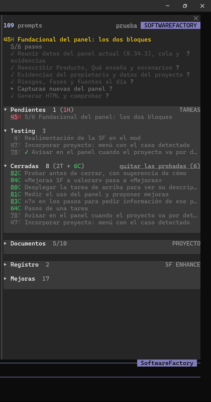
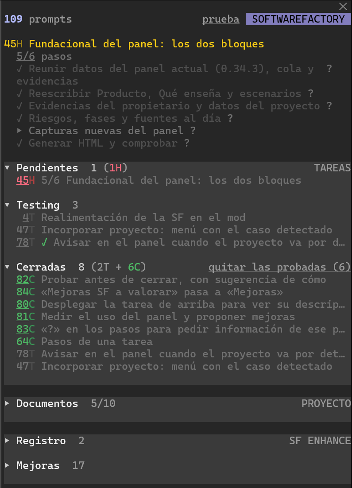

# Panel de la SF

> **Alcance**
> El panel existe y el propietario lo usa a diario: es el mod del plugin `sf`, versión 0.34.3, con 36 casos de prueba automáticos. Quedan tres funciones por probar, y las tres necesitan otro proyecto. Lo que este documento dice que aporta es un objetivo de diseño; lo que dice el propietario es su percepción, no una medida, y los hechos publicados llevan su referencia.

## Razón para desarrollar | El método, visible en cada sesión | Razón {#razon}

El panel de la SF es una columna junto a la conversación de Claude Code que enseña en qué se está trabajando, con qué pasos, qué espera en la cola, qué falta por probar y qué se ha cerrado. También hace cumplir solas algunas reglas del método. Su propósito es que quien dirige varios proyectos con Claude siga el hilo sin preguntarlo y no dependa de que Claude se acuerde de las reglas.

Claude Code ya ofrece formas de ver una sesión. La línea de estado ejecuta un script con los datos de la sesión y enseña contexto, coste o rama [[A3]](#src-A3 "Anthropic · línea de estado"){: .ref}. La vista de agentes lista las sesiones en segundo plano [[A4]](#src-A4 "Anthropic · vista de agentes"){: .ref}, y herramientas como ccusage cuentan tokens y coste [[T1]](#src-T1 "ccusage"){: .ref}. Ninguna conoce el método de trabajo del proyecto: su fase, su cola de peticiones, los pasos de cada tarea, lo que espera prueba o la regla de un proyecto por sesión.

La tesis es que el método se cumple mejor si se ve y se aplica dentro de la sesión, sin pasos a mano. Se apoya en cuatro hechos. Retomar una tarea interrumpida cuesta: solo el 10 % de las sesiones de programación estudiadas volvió a editar en menos de un minuto [[E1]](#src-E1 "Parnin y Rugaber, 2010"){: .ref}. El 27 de octubre de 2026, 33 de 43 peticiones quedaron sin probar; al día siguiente, con la regla de probar antes de cerrar, quedaban 3 [[M4]](#src-M4 "Cola e historial del 27 y 28 de octubre de 2026"){: .ref}. La interfaz de mods permite un panel acoplado junto a la conversación [[A2]](#src-A2 "Anthropic · interfaz de los mods"){: .ref}. Y el propietario, tras dos días de uso, dice que desarrollar con el panel «es más relajado» y que nota «mejor ordenamiento y control» [[M7]](#src-M7 "Registro de uso de la SF"){: .ref}. Falta saber si eso se mantiene con más proyectos y más días: es lo que debe observar el uso diario.

::: tarjetas 3

### Las peticiones llegan a mitad de otra tarea

Problema observado
{: .etiqueta-tarjeta}

El propietario pide cosas mientras Claude trabaja en otra. Antes de la cola, se acumulaban sin registro y varios cambios acababan en un mismo commit.

[[M1]](#src-M1 "Decisión «Cola de peticiones y un commit por petición»"){: .ref}

### Lo no probado se acumula

Dato del proyecto
{: .etiqueta-tarjeta}

En un solo día, 33 de 43 peticiones quedaron pendientes de una prueba que solo puede hacer el propietario. Bajó a 3 al proponer la prueba antes de cerrar cada una.

[[M4]](#src-M4 "Cola e historial del 27 y 28 de octubre de 2026"){: .ref}

### Una regla escrita no basta

Incidente registrado
{: .etiqueta-tarjeta}

Desde la sesión de la SF se editaron archivos de JKanban, que quedaron sin commit y mezclados en el historial, aunque la regla existía por escrito.

[[M1]](#src-M1 "Decisión «Un proyecto por sesión»"){: .ref}

:::

## Producto | Qué es el panel de la SF | Producto {#producto}

El panel es el mod del plugin `sf`: un módulo que Claude Code carga en todas las sesiones del usuario. En un proyecto bajo la SF, el que tiene `.sf/proyecto.json`, lee el estado del proyecto y lo dibuja en una columna a la derecha de la conversación. En los demás, enseña cómo incorporarlo [[M2]](#src-M2 "Especificación de la SF · Plugin y mods"){: .ref}.

Es el mismo en todos los proyectos, la SF incluida, sin adaptaciones [[M1]](#src-M1 "Decisión «Medir el uso del panel: cualitativo»"){: .ref}. Lee la carpeta `.sf/` y el historial de git; quien lleva la cola y hace los commits es Claude, siguiendo la metodología [[M6]](#src-M6 "Metodología de la SF, sección 2"){: .ref}. El panel solo escribe cuando el propietario lo pide con un clic o con `/paso`, y si falla, la sesión sigue igual.

<figure>

<figcaption>El panel de la SF con Claude Code a pantalla completa, el 28 de octubre de 2026: a la derecha de la conversación, sin tapar el prompt.</figcaption>
</figure>

::: tarjetas 3

### Tres bloques

**3** bloques plegables
{: .metrica}

Tareas, con Pendientes, Testing y Cerradas; Proyecto, con Documentos; y SF ENHANCE, con Registro y Mejoras.

### Cuatro letras de estado

**4** letras por tarea
{: .metrica}

A, actual; H, ya estaba al abrir la sesión; T, en Testing; C, cerrada y probada. La misma letra en todos los sitios.

### Escrituras solo a petición

**4** órdenes del propietario
{: .metrica}

Añadir o quitar un paso, borrar una entrada del registro y cambiar el modo prueba en la SF.

:::

### Cómo se entera de los cambios

Claude Code avisa al mod al empezar la sesión, al acabar cada turno y tras cada herramienta que puede escribir. En cada aviso, el mod relee `.sf/` y los últimos commits, de modo que un paso o una petición nueva aparece en el panel a mitad del turno, no al final.

<figure class="vertical">
<svg viewBox="0 0 560 560" width="100%" role="img" style="font-family:var(--fuente-texto);display:block">
<title>Claude escribe la cola, los pasos y los commits; el mod los lee en cada aviso y los dibuja en el panel; el propietario da órdenes desde el panel; el enlace con el Commander está previsto</title>
<rect x="60" y="14" width="440" height="80" rx="10" fill="none" style="stroke:var(--primario)" stroke-width="2"/>
<text x="280" y="46" text-anchor="middle" font-size="18" font-weight="700" style="fill:var(--oscuro)">Claude, en la sesión</text>
<text x="280" y="72" text-anchor="middle" font-size="15" style="fill:var(--texto-suave)">anota peticiones y pasos en .sf/ y hace commits</text>
<line x1="280" y1="94" x2="280" y2="150" style="stroke:var(--primario)" stroke-width="2"/>
<text x="292" y="128" font-size="15" style="fill:var(--texto-suave)">avisos de Claude Code</text>
<rect x="60" y="150" width="440" height="80" rx="10" fill="none" style="stroke:var(--primario)" stroke-width="2"/>
<text x="280" y="182" text-anchor="middle" font-size="18" font-weight="700" style="fill:var(--oscuro)">Mod de la SF</text>
<text x="280" y="208" text-anchor="middle" font-size="15" style="fill:var(--texto-suave)">lee .sf/ y git log · bloquea otro proyecto</text>
<line x1="280" y1="230" x2="280" y2="286" style="stroke:var(--primario)" stroke-width="2"/>
<rect x="60" y="286" width="440" height="80" rx="10" fill="none" style="stroke:var(--primario)" stroke-width="2"/>
<text x="280" y="318" text-anchor="middle" font-size="18" font-weight="700" style="fill:var(--oscuro)">Panel lateral</text>
<text x="280" y="344" text-anchor="middle" font-size="15" style="fill:var(--texto-suave)">tareas en curso, pasos y tres bloques</text>
<line x1="280" y1="366" x2="280" y2="452" style="stroke:var(--texto-suave)" stroke-width="2" stroke-dasharray="6 5"/>
<text x="292" y="414" font-size="15" style="fill:var(--texto-suave)">estado ↑ · órdenes ↓ · previsto</text>
<rect x="110" y="452" width="340" height="80" rx="10" fill="none" style="stroke:var(--texto-suave)" stroke-width="2" stroke-dasharray="7 5"/>
<text x="280" y="484" text-anchor="middle" font-size="18" font-weight="700" style="fill:var(--texto-suave)">Claude Code Commander</text>
<text x="280" y="510" text-anchor="middle" font-size="15" style="fill:var(--texto-suave)">previsto · todas las sesiones</text>
</svg>
<figcaption>Trazo continuo, lo que existe; discontinuo, lo previsto. El estado va de Claude al panel; las órdenes del propietario vuelven a Claude como peticiones.</figcaption>
</figure>

### Qué enseña

Arriba van el proyecto, su versión, su fase y su devslice. Si el proyecto se incorporó con una SF anterior, la versión sale como «SF 0.13 → 0.34.3» y un aviso dice cómo ponerlo al día. Debajo, en amarillo, las tareas en curso: la más reciente entera y las demás en una línea. Bajo cada una, su paso en curso con la cuenta, «1/3 Aplicarlo», o «6/6 pasos hechos» al acabar. El amarillo es solo para esta parte: lo que se está haciendo.

<figure>

<figcaption>El panel en el repositorio de la SF, el 28 de octubre de 2026: la tarea en curso con sus pasos desplegados y, debajo, los tres bloques con su cuenta en cada sección.</figcaption>
</figure>

Siguen los tres bloques, con secciones plegables y su cuenta en la cabecera. Tareas va en el orden del ciclo de una tarea: Pendientes, Testing, con qué probar y un «✓» en lo que Claude ya comprobó, y Cerradas, con lo cerrado en la sesión y su letra. Proyecto enseña, de momento, los documentos. SF ENHANCE reúne lo de la propia SF: el Registro de uso y las Mejoras que esperan el sí o no del propietario, vistos desde cualquier proyecto.

El ancho es escaso, así que cada tarea ocupa una línea recortada. Si tiene más que ver, su número va subrayado y un clic despliega el texto entero, la descripción, los pasos, el commit y qué probar. Los textos se escriben cortos, empezando por lo que cambia [[M1]](#src-M1 "Decisión «Textos compactos»"){: .ref}. No hay horas: el orden basta.

### Qué se hace desde el panel

`/paso texto` añade un paso a la tarea en curso al momento, también a mitad de turno, y se lo pide a Claude, que lo hace sin esperar un «continúa». Cada paso lleva un «?», que pide a Claude que lo explique sin tocar nada, y el pendiente, un «−» que lo quita. En el Registro, «→» pide a Claude una tarea a partir de una entrada y «−» la borra. En Cerradas, un botón quita las ya probadas.

### Qué hace cumplir

El mod bloquea, con el motivo, cualquier escritura de archivos en otro proyecto. Las únicas excepciones son registrar una propuesta de mejora en la SF o anotar en su registro de uso. Además pone a la sesión el color y el nombre del proyecto, y avisa si el proyecto va por detrás de la SF instalada.

### Qué no hace

No decide qué es una petición ni la anota: eso lo hace Claude. No ve las otras sesiones abiertas, porque un mod solo conoce la suya. No controla las órdenes de terminal, que quedan bajo la regla escrita. En un terminal estrecho, el panel no cabe junto a la conversación y queda una caja pequeña sobre el prompt [[A2]](#src-A2 "Anthropic · interfaz de los mods"){: .ref}.

### Cómo crece

Las nuevas responsabilidades de control de la SF se plantean primero en el panel [[M1]](#src-M1 "Decisión «El mod, centro de control de la SF»"){: .ref}, y lo que se observa al usarlo entra en su Registro, que es la fuente de sus mejoras. Cuando exista el Claude Code Commander, el mod de cada sesión será su enlace: le enviará el estado y recogerá sus órdenes [[M5]](#src-M5 "Fundacional del Claude Code Commander"){: .ref}. Con JKanban incorporado, cada petición será una tarea del tablero y el archivo de la cola, su copia sin conexión.

## Escenarios de uso | Siete situaciones en las que el panel aporta valor | S1–S7 {#escenarios}

El panel aporta valor en el trabajo diario dentro de una sesión: al volver a ella, al recibir peticiones sueltas, al seguir una tarea larga y al cerrar lo empezado. Con varias sesiones a la vez, cada panel ve solo la suya; esa vista de conjunto es del Commander. Los siete escenarios son compatibles y un mismo día pasa por todos.

La base de cada escenario es un hecho del propio proyecto o una fuente publicada. El valor descrito es un objetivo de diseño.
{: .texto}

::: tarjetas 2

### S1 · Saber en qué estoy al volver {: #S1}

Cuándo aporta valor
:   Al volver a una sesión tras una pausa o tras atender otro proyecto: la tarea en curso y su paso están arriba, sin preguntarle a Claude.

Límite del argumento
:   Ver la tarea y el paso no basta para retomar el razonamiento que había detrás.

Qué observar
:   Si el propietario pregunta menos «¿en qué estábamos?» al volver.

[[E1]](#src-E1 "Parnin y Rugaber, 2010"){: .ref}

### S2 · Una petición a mitad de otra {: #S2}

Cuándo aporta valor
:   Cuando el propietario pide algo mientras Claude trabaja: entra en la cola con su letra y se ve, y la tarea en curso no se pierde.

Límite del argumento
:   Depende de que Claude anote cada petición; el panel no las detecta.

Qué observar
:   Peticiones anotadas frente a las pedidas, y commits que mezclan dos.

[[M1]](#src-M1 "Decisión «Cola de peticiones»"){: .ref}

### S3 · Seguir una tarea larga {: #S3}

Cuándo aporta valor
:   En una tarea de varios pasos: el paso en curso se ve, el propietario añade otro con `/paso` sin cortar a Claude, y con «?» pide que se le explique uno.

Límite del argumento
:   Los pasos los escribe y actualiza Claude; si no lo hace al momento, el panel se queda atrás.

Qué observar
:   Si los encargos entran como pasos y no como tareas sueltas.

[[M1]](#src-M1 "Decisión «Pasos de una tarea»"){: .ref}

### S4 · Qué falta por probar {: #S4}

Cuándo aporta valor
:   Al acabar una tarea o tras actualizar el plugin: Testing dice qué comprobar en cada caso, y Cerradas, qué se cerró en la sesión y si ya está probado.

Límite del argumento
:   Enseñar la lista no hace la prueba; si crece sin parar, se deja de mirar.

Qué observar
:   Tareas en Testing al final de cada día y cuántos días tarda cada una en salir.

[[M4]](#src-M4 "Cola del 27 y 28 de octubre de 2026"){: .ref}

### S5 · No mezclar proyectos {: #S5}

Cuándo aporta valor
:   Cuando Claude intenta editar otro proyecto desde la sesión: el mod lo bloquea y dice por qué.

Límite del argumento
:   Solo cubre las escrituras de archivos, no las órdenes de terminal.

Qué observar
:   Bloqueos y commits con cambios de dos proyectos.

[[M1]](#src-M1 "Decisión «Un proyecto por sesión»"){: .ref}

### S6 · Mejorar la SF mientras se usa {: #S6}

Cuándo aporta valor
:   En cualquier proyecto: lo que Claude observa del uso de la SF entra en el Registro, y el propietario lo borra o lo convierte en tarea con un clic. Las Mejoras esperan su sí o no.

Límite del argumento
:   Qué es significativo sigue siendo juicio de Claude; un registro que se llena de detalles deja de leerse.

Qué observar
:   Entradas convertidas en tarea y mejoras decididas.

[[M1]](#src-M1 "Decisión «Medir el uso del panel: cualitativo»"){: .ref}

### S7 · Proyecto atrasado {: #S7}

Cuándo aporta valor
:   Al abrir un proyecto incorporado con una SF anterior: la cabecera enseña las dos versiones y cómo ponerlo al día.

Límite del argumento
:   Avisa, no actualiza; ponerlo al día es una tarea de su propia sesión.

Qué observar
:   Días entre el aviso y la puesta al día.

[[M1]](#src-M1 "Decisión «El panel avisa si el proyecto va por detrás de la SF»"){: .ref}

:::

## Alternativas | Qué existe hoy y qué aporta el panel | Alternativas {#alternativas}

Las alternativas cubren bien el uso técnico de la sesión: contexto, coste y rama. Ninguna lee el estado del método del proyecto, ni hace cumplir sus reglas. El panel no compite con ellas: puede convivir con una línea de estado propia del usuario, que el panel deja libre [[M1]](#src-M1 "Decisión «Sin línea de estado»"){: .ref}.

::: tarjetas 2

### Línea de estado de Claude Code

Anthropic
{: .etiqueta-tarjeta}

Una fila bajo el prompt que ejecuta un script con los datos de la sesión, como el contexto, el coste o la rama de git.

Lectura para el proyecto
:   Sirve para una o dos líneas; no tiene secciones ni clics, y cuando la escribe un mod sale con un aviso delante.

[[A3]](#src-A3 "Anthropic · línea de estado"){: .ref} [[A1]](#src-A1 "Anthropic · API de los mods"){: .ref}

### Vista de agentes

Anthropic
{: .etiqueta-tarjeta}

Lista las sesiones que trabajan en segundo plano y su estado.

Lectura para el proyecto
:   Ve varias sesiones, pero no la fase, la cola, los pasos ni lo que falta por probar de cada proyecto.

[[A4]](#src-A4 "Anthropic · vista de agentes"){: .ref}

### Métricas de uso

ccusage
{: .etiqueta-tarjeta}

Cuenta tokens y coste por día, sesión y bloque, a partir de los registros locales.

Lectura para el proyecto
:   Mide el consumo, no el trabajo terminado ni el dejado a medias.

[[T1]](#src-T1 "ccusage"){: .ref}

### Solo reglas escritas

`CLAUDE.md` y metodología
{: .etiqueta-tarjeta}

Las reglas del método están por escrito y Claude las lee al empezar.

Lectura para el proyecto
:   Funcionan mientras Claude las recuerda; el incidente entre la SF y JKanban ocurrió con la regla escrita.

[[M1]](#src-M1 "Decisión «Un proyecto por sesión»"){: .ref}

:::

## Evidencias | Qué respalda cada fuente y qué no | Evidencias {#evidencias}

Las evidencias publicadas se buscaron el 27 de octubre de 2026 en la literatura sobre interrupciones y en la documentación oficial de Claude Code; las del proyecto son de su cola, su historial y su registro de uso. Respaldan que interrumpir y retomar tiene un coste, que el panel se puede construir con piezas oficiales y que su primer usuario lo vive como una ayuda. No demuestran todavía que el panel reduzca ese coste por sí solo.

Los datos del proyecto son de dos días y de una sola persona. Sirven para describir el problema y la primera impresión, no para generalizarlos.
{: .texto}

::: tarjetas 2

### Retomar una tarea cuesta

Estudio · 10.000 sesiones de programación
{: .etiqueta-tarjeta}

Solo el 10 % de las sesiones estudiadas empezó a editar en menos de un minuto tras volver a una tarea; en el 30 %, la primera edición llegó después de media hora.

Escenarios
:   [S1](#S1){: .insignia} [S3](#S3){: .insignia}

Lectura para el proyecto
:   Respalda que conviene dejar a la vista dónde se estaba. No mide sesiones con agentes de IA.

[[E1]](#src-E1 "Parnin y Rugaber, 2010"){: .ref}

### Interrumpido, más rápido y con más estrés

Experimento · CHI 2008
{: .etiqueta-tarjeta}

Las personas interrumpidas terminaron sus tareas en menos tiempo y con la misma calidad, pero con más estrés, frustración, presión de tiempo y esfuerzo.

Escenarios
:   [S2](#S2){: .insignia} [S3](#S3){: .insignia}

Lectura para el proyecto
:   Respalda que el coste de las interrupciones lo paga la persona, aunque el trabajo salga. Es un experimento con tareas de oficina, no de programación.

[[E2]](#src-E2 "Mark, Gudith y Klocke, 2008"){: .ref}

### La productividad cae con el cuarto agente

Estudio de BCG, citado por Built In
{: .etiqueta-tarjeta}

Con casi 1.500 trabajadores, la productividad sube con los tres primeros agentes y cae con el cuarto; el agotamiento se asocia a más errores graves.

Escenarios
:   [S4](#S4){: .insignia}

Lectura para el proyecto
:   Respalda vigilar lo que queda a medias. Es un artículo sobre el estudio y no se limita a programadores.

[[E3]](#src-E3 "Built In sobre el estudio de BCG, 2026"){: .ref}

### La ironía de la automatización

Artículo clásico · 1983
{: .etiqueta-tarjeta}

Cuanto más automático es un sistema, más exigente es el papel de quien lo supervisa.

Escenarios
:   [S1](#S1){: .insignia} [S4](#S4){: .insignia}

Lectura para el proyecto
:   Respalda dar a quien supervisa una vista clara de lo que hace Claude. Es de control industrial, no de software.

[[E4]](#src-E4 "Bainbridge, 1983"){: .ref}

### El panel se puede construir

Documentación oficial
{: .etiqueta-tarjeta}

Un mod puede abrir un panel que se acopla junto a la conversación si el terminal tiene 800 píxeles o más; si no, va sobre el prompt con 12 filas. Lee archivos, lanza procesos y guarda datos entre sesiones.

Escenarios
:   [S1](#S1){: .insignia} [S4](#S4){: .insignia} [S5](#S5){: .insignia}

Lectura para el proyecto
:   Respalda la forma elegida. La API de mods es reciente y puede cambiar.

[[A1]](#src-A1 "Anthropic · API de los mods"){: .ref} [[A2]](#src-A2 "Anthropic · interfaz de los mods"){: .ref}

### Dos días de trabajo real

Datos del proyecto · 27 y 28 de octubre de 2026
{: .etiqueta-tarjeta}

El 27, el panel pasó de la versión 0.2.0 a la 0.25.2 y 33 de 43 peticiones quedaron sin probar. El 28 llegó a la 0.34.3, con 60 commits más y 41 peticiones nuevas, y en Testing quedaron 3.

Escenarios
:   [S2](#S2){: .insignia} [S4](#S4){: .insignia}

Lectura para el proyecto
:   Respalda que la cola recoge el ritmo real y que proponer la prueba al cerrar vacía Testing. No separa el efecto del panel del de esa regla ni del tiempo que el propietario dedicó a probar.

[[M4]](#src-M4 "Cola e historial del 27 y 28 de octubre de 2026"){: .ref}

### Lo que dice el primer usuario

Testimonio · propietario de la SF
{: .etiqueta-tarjeta}

El 27: «es más relajado desarrollar con el panel, menos sensación de estrés al poder seguir el hilo sin tirar tanto de memoria». El 28: «noto mejor ordenamiento y control» y «el panel se está convirtiendo en una herramienta importante para mi trabajo con cc».

Escenarios
:   [S1](#S1){: .insignia} [S3](#S3){: .insignia} [S4](#S4){: .insignia}

Lectura para el proyecto
:   Respalda que el panel atiende el coste que describe la literatura: menos memoria y menos estrés. Es la percepción de una persona, que además lo ha diseñado, tras dos días de uso.

[[M7]](#src-M7 "Registro de uso de la SF"){: .ref}

:::

## Riesgos | Qué puede fallar y cómo se mitiga | Riesgos {#riesgos}

El riesgo principal ya no es lo construido sin probar, sino que el panel crezca más deprisa de lo que se usa: cada función nueva es una línea más en poco ancho. El plan lo ataca con el Registro, que recoge las fricciones del uso real, y con la regla de no añadir sin una observación que lo pida.

::: tarjetas 2

### Pruebas que necesitan otro proyecto

Técnico
{: .etiqueta-tarjeta}

Mitigación
:   Las tres funciones en Testing se prueban al abrir JKanban y SmartColdBox en su propia sesión, y el panel las sigue enseñando hasta entonces.

Se comprueba en
:   [Fase 1](#fases).

### La API de mods cambia

Técnico
{: .etiqueta-tarjeta}

Mitigación
:   36 casos de prueba automáticos, poca lógica en cada dibujo y revisión en cada versión de Claude Code.

Se comprueba en
:   [Fase 1](#fases) y cada actualización.

### La cola o los pasos se quedan atrás

Operativo
{: .etiqueta-tarjeta}

Mitigación
:   La regla está en la metodología y en el `CLAUDE.md` de cada proyecto; el panel enseña lo que hay, y una tarea sin pasos al día se nota.

Se comprueba en
:   [Fase 2](#fases), con el Registro.

### Demasiado en poco ancho

Humano
{: .etiqueta-tarjeta}

Mitigación
:   Bloques y secciones plegables, una línea por tarea, sin horas, amarillo solo arriba y nada repetido entre el panel y el resto de la pantalla.

Se comprueba en
:   [Fase 2](#fases), con el uso diario.

### Percepción del propio autor

Humano
{: .etiqueta-tarjeta}

Mitigación
:   Anotar también las fricciones, con sus palabras y su proyecto, y contrastar la impresión con otros usuarios cuando los haya.

Se comprueba en
:   [Fase 2](#fases) y [Fase 3](#fases).

### Anthropic lo cubre antes

Estratégico
{: .etiqueta-tarjeta}

Mitigación
:   Quedarse en la capa del método, que Claude Code no conoce, y dejar lo técnico a sus piezas.

Se comprueba en
:   La revisión de novedades al empezar cada fase.

:::

## Qué debe demostrar | Del código probado al uso diario | Fases {#fases}

El panel se demuestra usándolo. Lo construido está casi todo probado; ahora toca observar si cambia la forma de trabajar en varios proyectos y, después, conectarlo con el Commander y con JKanban. La observación es cualitativa: fricciones, aciertos y lo que dice el propietario, en el Registro [[M1]](#src-M1 "Decisión «Medir el uso del panel: cualitativo»"){: .ref}.

::: tarjetas 3

### Fase 1 · Probar lo construido

Circuito
:   Las tres funciones en Testing, en JKanban y SmartColdBox, tras actualizar el plugin.

Motivo
:   Nada de lo demás vale si el panel no hace lo que dice.

Condición para avanzar
:   Ninguna tarea en Testing de más de una semana.

### Fase 2 · Uso diario observado

Circuito
:   Dos semanas de trabajo normal con el panel abierto, en la SF y en otros proyectos.

Motivo
:   Comprobar si la vista cambia el trabajo, no solo si funciona.

Condición para avanzar
:   El Registro confirma la impresión de orden y control también fuera de la SF, y sus fricciones se han resuelto o están en la cola.

### Fase 3 · Enlace

Circuito
:   El mod envía su estado al Commander; la cola pasa a JKanban.

Motivo
:   Una sesión no ve a las otras; la vista de conjunto necesita el enlace.

Condición para avanzar
:   El estado llega sin pérdidas y el panel sigue funcionando si el Commander cae.

:::

### Decisiones de avance

Antes de la fase 3 se decide el canal entre el mod y el Commander, que está en la propuesta del Commander [[M3]](#src-M3 "Propuesta «Claude Code Commander: lo que falta concretar»"){: .ref}.

Se valida en tres planos. El técnico, que cada función hace lo que dice en una sesión real. El operativo, que la cola y los pasos se mantienen al día sin pedirlo. El de la persona, que retomar cuesta menos y lo empezado se cierra.

> [!decision]
> **Decisión propuesta**
> Cerrar las tres pruebas pendientes en sus proyectos y observar dos semanas de uso con el Registro antes de añadir funciones que no pida una observación.

## Fuentes | Fuentes y referencias | Fuentes {#fuentes}

Fuentes revisadas el 27 y el 28 de octubre de 2026. E = estudios y evidencias; A = documentación de Anthropic; T = productos comparables; M = documentos y datos del propio proyecto.
{: .nota}

::: fuentes

**E1 · Parnin y Rugaber, 2010** Resumption strategies for interrupted programming tasks. [Abrir fuente ↗](https://sites.cc.gatech.edu/reverse/repository/resumptionstrategies.pdf)
{: #src-E1}

**E2 · Mark, Gudith y Klocke, 2008** The cost of interrupted work: more speed and stress. CHI 2008, 107-110. [Abrir fuente ↗](https://www.ics.uci.edu/~gmark/chi08-mark.pdf)
{: #src-E2}

**E3 · Built In, 10 de junio de 2026** AI brain fry, sobre el estudio de BCG. La fecha del estudio no es clara: el artículo dice abril y la página de BCG, 5 de marzo. [Abrir fuente ↗](https://builtin.com/articles/ai-brain-fry-software-developers)
{: #src-E3}

**E4 · Bainbridge, 1983** Ironies of Automation. [Abrir fuente ↗](https://gwern.net/doc/sociology/technology/1983-bainbridge.pdf)
{: #src-E4}

**A1 · Anthropic** API de los mods de Claude Code. [Abrir fuente ↗](https://code.claude.com/docs/en/plugins/mods/api.md)
{: #src-A1}

**A2 · Anthropic** Dibujar en la interfaz con un mod: paneles, banda sobre el prompt y su colocación según el ancho. [Abrir fuente ↗](https://code.claude.com/docs/en/plugins/mods/interface.md)
{: #src-A2}

**A3 · Anthropic** Línea de estado de Claude Code. [Abrir fuente ↗](https://code.claude.com/docs/en/statusline.md)
{: #src-A3}

**A4 · Anthropic** Vista de agentes de Claude Code. [Abrir fuente ↗](https://code.claude.com/docs/en/agent-view.md)
{: #src-A4}

**T1 · ccusage** Tokens y coste por día, sesión y bloque, a partir de los registros locales. [Abrir fuente ↗](https://github.com/ryoppippi/ccusage)
{: #src-T1}

**M1 · Decisiones de la SF** Cola de peticiones, un proyecto por sesión, realimentación, pasos de una tarea, probar antes de cerrar, aviso de versión, registro de uso, panel estándar, sin línea de estado, textos compactos y el mod como centro de control, en `docs/decisiones/`. [Abrir documento](../../decisiones/README.md)
{: #src-M1}

**M2 · Especificación de la SF** Apartado «Plugin y mods de la SF», con el contenido actual del mod. [Abrir documento](../funcional/software-factory.md)
{: #src-M2}

**M3 · Propuesta «Claude Code Commander: lo que falta concretar»** Canal entre el mod y el Commander, en `docs/propuestas.md`. [Abrir documento](../../propuestas.md)
{: #src-M3}

**M4 · Cola e historial del 27 y 28 de octubre de 2026** `.sf/peticiones.json` de la SF (43 peticiones y 33 sin probar el 27; 41 más y 3 en Testing el 28) y los commits de `plugins/sf/hooks` y `plugins/sf/tests` (de la versión 0.2.0 a la 0.25.2 el 27, y 60 más hasta la 0.34.3 el 28).
{: #src-M4}

**M5 · Fundacional del Claude Code Commander** El mod como enlace de cada sesión. [Abrir documento](fundacional-claude-code-commander.html)
{: #src-M5}

**M6 · Metodología de la SF, sección 2** Cola de peticiones, pasos y un commit por petición. [Abrir documento](../../../plugins/sf/skills/metodologia/references/desarrollo-de-proyectos.md)
{: #src-M6}

**M7 · Registro de uso de la SF** Lo que observa Claude y lo que dice el propietario al trabajar con el panel, en `.sf/registro.json` de la SF y en `docs/uso-del-panel.md`. [Abrir documento](../../uso-del-panel.md)
{: #src-M7}

:::
